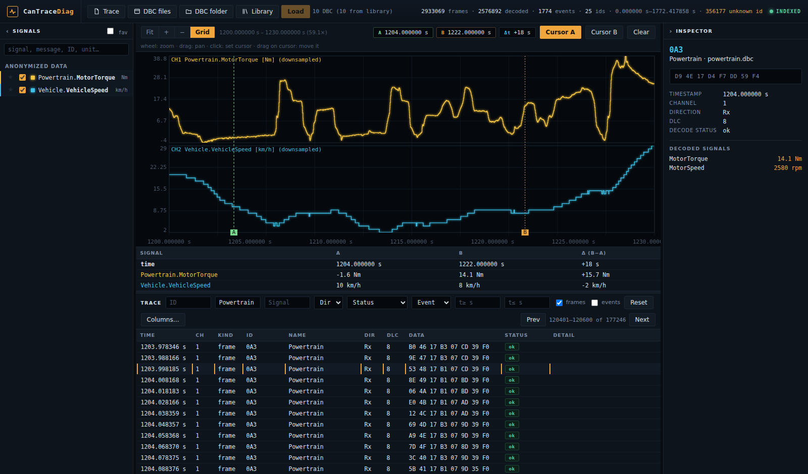
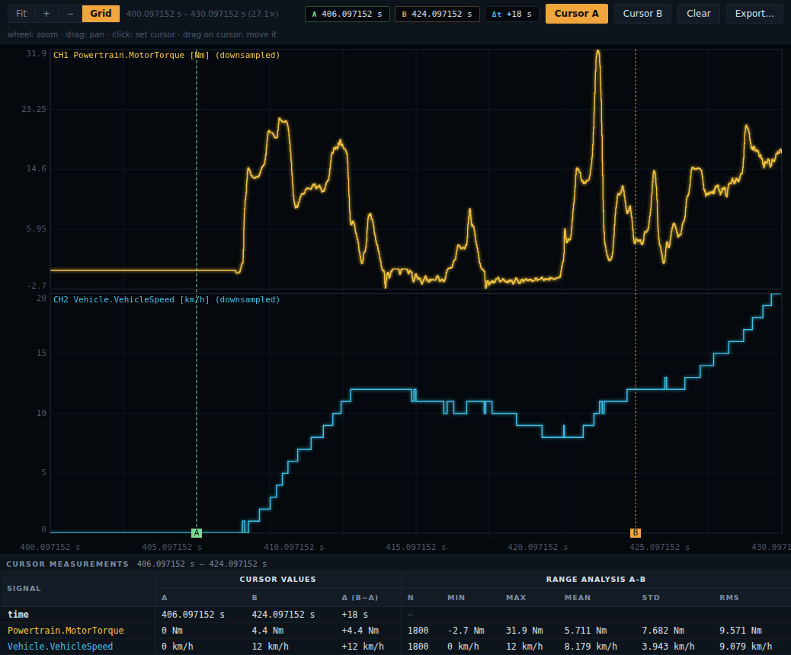
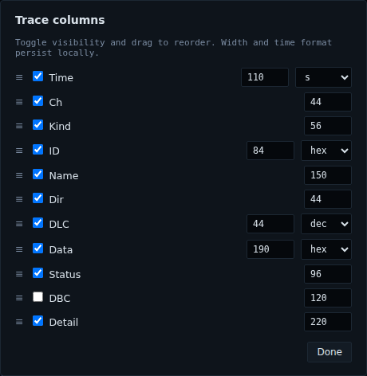
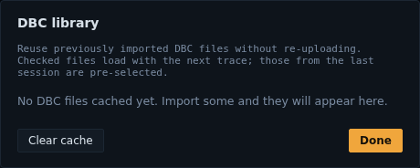

# CanTraceDiag

## Production architecture

The deployed product is the static PWA generated from
`spikes/pwa-local-engine/`. It is the canonical user path and is validated by
the Node 22 PWA tests and build in every pull request. The Python/FastAPI path
is retained as a local/API reference implementation and compatibility suite;
it is not the artifact served by the production Docker image. See
`docs/architecture-pwa-canonique.md` for the boundary and validation contract.

**CanTraceDiag turns an ASC, supported text `.trc`, Vector `.blf`, or raw-CAN MDF4 `.mf4` trace and its DBC files into a local diagnostic workstation: import, decode, synchronized plots, A/B cursors, a filterable trace view, session restore, and raw ASC conversion.**

The goal is direct: inspect real CAN acquisitions away from the vehicle, without a remote server, without keeping a proprietary tool open, and without loading the whole trace into the browser.



## Core Features

- **ASC/TRC/BLF + DBC import** from the browser or server-side paths. The supported PCAN-View text TRC v1.1 layout and ASC both retain malformed records as explicit import anomalies instead of corrupt frames. Vector BLF imports the classic-CAN object subset the same way, turning CAN FD/XL objects, remote requests, error frames, and integrity failures into inspectable diagnostics; a corrupt container fails the import rather than publishing a partial trace.
- **Raw CAN MF4 import** (server mode) of ASAM MDF 4.x bus logging (`CAN_DataFrame` groups), including recordings a logger left *unfinalized* (`UnFinMF`, zero cycle counters, stale last-DT length). Recovery happens only in a temporary copy -- the source file is never modified -- and an independent byte reconciliation refuses truncated or mis-recovered data instead of importing it partially. Groups are merged chronologically (ties: group order, then record order); timestamps keep the measurement-relative origin; sparse bus numbers, extended IDs and known Rx/Tx are kept. Remote/error/CAN FD records, malformed frames and non-CAN groups (LIN...) become diagnostics; a recovery warning is shown with the import.
- **Multi-DBC decoding** with ambiguous arbitration ID detection.
- **Stacked signal plots** with zoom, pan, grid, and A/B cursors.
- **Workspace views** from a single control — Plots, Plots + trace (split with a resizable divider), Trace, and Report — that switch layout while preserving selection, cursors, and filters.
- **Unified measurement table** below the plot, combining A/B cursor values with the A–B range statistics (count, min, max, mean, std, RMS), plus value distributions for text/enum signals.
- **Opt-in cursor integral**: an explicit **∫ Integral** action computes the signed time integral of one plotted signal between cursors A and B (unit × s, e.g. A·s). It uses trapezoidal (linear) interpolation over the full-resolution samples — not the plot's sample-and-hold steps nor its downsampled points — interpolates exact cursor boundaries, never extrapolates, and reports an explicit reason when coverage is missing, the signal is text, or samples are invalid. It is off by default and on every new trace.
- **Diagnostic report** summarizing the import: time range, volumes, DBCs used, and anomalies by type.
- **Streamed export** of selected signals to CSV or Parquet over a chosen range, with bounded memory.
- **Raw trace to ASC** (server mode): save every stored classic-CAN frame of the full trace, the A–B range or the visible window (inclusive) as a Vector-style `.asc`, without a DBC or selected signals, from any source format. Relative timestamps with six decimals (re-import error at most 0.5 µs), original numeric channels, `x`-suffixed extended IDs, exact DLC/payload and direction. Excluded events and import warnings are shown before download and written as header comments; frames without a numeric channel or direction block the export unless you explicitly choose to write them as channel 1 / Rx (disclosed in the file).
- **Trace table** with pagination, filtering, and configurable columns.
- **Frame inspector** with raw payload, decoded message, and physical signals.
- **Compact signal explorer**: collapsible DBC groups with the active database first and expanded, plus displayed-only and favorites-only filters that intersect with the text search.
- **Local DBC library** to reuse databases without uploading them again; the exact DBC set of the last successful load (by content, not file name) is prechecked after a browser reload or restart, so the next load only needs a new trace.
- **Keyboard-accessible controls** (favorites, filters, table rows, dialogs, resizers) with Pointer-Events graph and resize interactions, verified across the 1024×768 / 1280×720 / 1600×900 desktop viewports plus minimal 390×844 support.
- **Browser fullscreen control** requesting document fullscreen from the user gesture, following native exits (Escape, F11, browser UI) and reporting a refusal inline.
- **Session restore** through a local workspace outside the repository.
- **Standalone Windows executable** fetched, verified and started by a double-clickable `CanTraceDiag.cmd`, for ASC traces up to 1 GiB, without Python or WSL.
- **One-click Windows + WSL launcher** with a desktop shortcut (developers).

## Quick Start

Prerequisite: Python 3.11+.

```bash
git clone https://github.com/Jilanos/CanTraceDiag.git
cd CanTraceDiag
python -m venv .venv
source .venv/bin/activate
python -m pip install -U pip
python -m pip install -e ".[api,dev]"
cantracediag --help
pytest
cantracediag serve --open
```

[](https://github.com/Jilanos/CanTraceDiag/actions/workflows/ci.yml)

## Preview

### Plots And Cursors

Selected signals are rendered as stepped traces on a shared time axis. A/B cursors can be placed by click, moved by drag, and feed the measurement table below the plot.



### Trace Columns

The trace view is built for repeated inspection: filters, pagination, decode status, frame selection, and locally persisted column order, width, and format.



### DBC Library

Imported DBC files are kept in the user workspace, deduplicated by content, and reusable on the next load. The picker prechecks the DBCs of the last successful load that are still in the library, once per picker state; manual changes, including unchecking everything, are kept across reopening the library. Failed, cancelled, or unresolved imports keep the previous set, and **Clear cache** forgets it.



## Developer Setup

For local development, install the package with API and development dependencies:

```bash
python -m venv .venv
source .venv/bin/activate
python -m pip install -U pip
python -m pip install -e ".[api,dev]"
```

Recommended local validation:

```bash
.venv/bin/ruff check .
.venv/bin/pytest
```

## Run The UI

From the virtual environment:

```bash
cantracediag serve --open
```

From source without the installed script:

```bash
PYTHONPATH=src python -m cantracediag.cli serve --open
```

The default UI URL is:

```text
http://127.0.0.1:8000
```

If the requested port is already busy, `serve` picks a free one. If a CanTraceDiag instance is already running on that port, the command reopens the browser instead of starting a second server.

## Windows Standalone (No Python, No WSL)

For an operator who only has Windows 11 x64 and a browser: clone the repository (or check out a release tag) and double-click **`CanTraceDiag.cmd`** at the repository root. No Python, Node, WSL, Docker or administrator rights are needed.

What the launcher does:

1. reads the checkout's version (`src/cantracediag/__init__.py`) and commit (`.git`, no git installation needed);
2. resolves the GitHub release `v<version>` and checks its provenance: same version and tag, `windows/x64`, and **exactly this checkout's commit**;
3. downloads `CanTraceDiag-<version>-windows-x64.exe` and verifies its SHA-256 against both the published `.sha256` file and the provenance **before** anything runs;
4. caches the verified executable under `%LOCALAPPDATA%\CanTraceDiag\releases\v<version>\`. Later launches re-verify the cached file and work offline.

Only published releases get a binary. A development checkout fails with instructions instead of silently downloading another version: run `git checkout vX.Y.Z` (a published release tag) or `CanTraceDiag.cmd -Release vX.Y.Z`. Missing assets, network failures, incomplete downloads, checksum mismatches and non-x64 machines all stop before execution. No binary is ever committed to the repository.

The executable starts a **loopback-only** service (`127.0.0.1`, port 8000 or the next usable one) and opens your default browser on the familiar UI once it is ready. Keep its console window open while you work; **closing it (or Ctrl+C) stops CanTraceDiag**. `CanTraceDiag.cmd --stop` stops it from elsewhere. Launching it again while it runs just reopens the browser; a different running version is reported, not replaced.

Per-user locations (never inside the clone, so a clone on a `\\wsl.localhost\...` share works too):

| What | Where |
| --- | --- |
| DBC library, last analysis, upload staging | `%LOCALAPPDATA%\CanTraceDiag\data\` |
| Service log (rotated, 3 x 5 MiB) | `%LOCALAPPDATA%\CanTraceDiag\logs\cantracediag.log` |
| Running instance (port, version) | `%LOCALAPPDATA%\CanTraceDiag\instance.json` |
| Verified downloaded executables | `%LOCALAPPDATA%\CanTraceDiag\releases\` |

Capacity: the Windows local application accepts an ASC trace up to **exactly 1 GiB (1,073,741,824 bytes, inclusive)** through the normal file picker, with a separate 64 MiB budget for uploaded DBC files and 8 MiB for the upload envelope; 1 GiB + 1 byte is refused with a clear message. The upload streams to disk, the trace is indexed in bounded batches into a DuckDB file, and signals are decoded lazily per plotted signal. Cancel works during the transfer and during indexing and keeps the previous analysis. The 1 GiB guarantee applies to ASC; TRC, BLF and raw-CAN MF4 are supported by the executable without a size guarantee. The hosted web app (static PWA) keeps its own, smaller, browser-memory-bound limits.

The executable is **not code-signed**: Windows SmartScreen may show "Windows protected your PC" the first time; choose *More info* then *Run anyway* only for a file obtained through the launcher (which verified its SHA-256 against the release). Bundled third-party components and their licenses are listed in `THIRD_PARTY_NOTICES.txt`, published with each release.

Building it yourself on Windows x64 (needs Python 3.13 on the build machine only):

```powershell
.\packaging\windows\build.ps1          # -> dist\windows\CanTraceDiag-<version>-windows-x64.exe (+ .sha256, provenance, notices)
python packaging\windows\smoke.py dist\windows\CanTraceDiag-<version>-windows-x64.exe
```

## One-Click Windows + WSL Launch (Developers)

Run this once per Windows machine from Windows PowerShell:

```powershell
cd "\\wsl.localhost\Ubuntu\path\to\CanTraceDiag"
powershell.exe -NoProfile -ExecutionPolicy Bypass -File .\scripts\install-shortcut.ps1
```

The script creates:

- `CanTraceDiag.local.cmd` at the repository root, with the clone's WSL path baked in;
- a **CanTraceDiag** desktop shortcut;
- the project icon on that shortcut, copied to a Windows-local icon cache.

After that, double-clicking the shortcut starts the WSL server and opens the Windows browser. Re-run the script after moving the clone or after updating the icon.

## Quick Test

The synthetic fixtures exercise the full flow:

```bash
cantracediag info tests/fixtures/sample.asc --dbc tests/fixtures/sample.dbc
cantracediag info tests/fixtures/sample.trc --dbc tests/fixtures/sample.dbc
cantracediag signals tests/fixtures/sample.dbc
cantracediag serve --open
```

In the UI:

1. Click **Trace** and choose `tests/fixtures/sample.asc`.
2. Click **DBC files** and choose `tests/fixtures/sample.dbc`.
3. Click **Load**.
4. Select signals in the **Signals** panel.
5. Try zoom, pan, A/B cursors, trace filters, **Columns...**, **Library**, and **Clear cache**.

From the Windows browser, the WSL repository is visible through a path like:

```text
\\wsl.localhost\Ubuntu\path\to\CanTraceDiag\tests\fixtures
```

## Privacy And Sample Data

The fixtures in `tests/fixtures/` are synthetic and safe to version. Real traces, real DBC files, and generated workspaces should stay outside the repository; the default local workspace is ignored by Git.

## User Workflow

1. **Import** one `.asc`, supported text `.trc`, Vector `.blf`, or raw-CAN `.mf4` trace and, to decode signals, one or more `.dbc` files.
2. **Resolve DBC conflicts** when several databases define the same arbitration ID with non-equivalent messages.
3. **Select signals** present in the trace or available in the DBC catalog.
4. **Switch workspace views** — Plots, Plots + trace (split), Trace, or Report — from the single view control; switching keeps your selection, cursors, and filters.
5. **Explore plots** with zoom, pan, grid, and A/B cursors, and read the unified measurement table (cursor values + A–B range statistics) below the plot; enable **∫ Integral** when you need the integral of one signal between the cursors.
6. **Inspect the trace** with filters, pagination, frame details, and decoded signals, using the split view to keep plots and trace side by side.
7. **Review the report** for the import synthesis and anomalies, then **export** the selected signals to CSV or Parquet over the range you choose (between A and B, the visible window, or the full trace) -- or save the raw CAN trace of that range as ASC, which needs no DBC or signal.
8. **Reopen later** and let the workspace restore the last analysis and DBC library.

## Command Line

```bash
# Summarize an import
cantracediag info /path/to/trace.asc --dbc system.dbc --dbc auxiliary.dbc
# A verified PCAN-View text TRC v1.1 file is supported too.
cantracediag info /path/to/trace.trc --dbc system.dbc --dbc auxiliary.dbc
# So is a Vector BLF recording (classic CAN data frames).
cantracediag info /path/to/trace.blf --dbc system.dbc --dbc auxiliary.dbc
# And an MDF4 raw CAN bus logging recording, finalized or not (prints warnings).
cantracediag info /path/to/00000002.MF4

# Save any supported trace's raw CAN frames as ASC (no DBC needed; never overwrites)
cantracediag export-asc /path/to/00000002.MF4 /path/to/00000002.asc
cantracediag export-asc /path/to/trace.blf out.asc --start 10 --end 20
# Frames without a numeric channel / direction are refused unless you opt in:
cantracediag export-asc /path/to/trace.mf4 out.asc --assume-provenance

# List messages and signals from one or more DBC files
cantracediag signals system.dbc

# Start the local UI
cantracediag serve --port 8000 --open

# Expose on the LAN (binds 0.0.0.0; the printed token protects the whole API)
cantracediag serve --lan --port 8000
```

## Local API

CanTraceDiag exposes a local FastAPI API used by the UI:

- `POST /api/import-files`: browser upload import;
- `POST /api/import`: server-side path import;
- `POST /api/resolve`: DBC conflict resolution;
- `GET /api/status`: session state and backend capabilities (accepted trace suffixes, raw ASC export);
- `GET /api/signals`: signal catalog plus the ordered loaded DBCs and the active one;
- `GET /api/series`: windowed/downsampled series;
- `GET /api/cursor`: nearest cursor value for one signal (bounded lookup);
- `POST /api/cursors`: nearest values for N signals at cursors A and B in one call;
- `GET /api/signal-stats`: range statistics for one signal between two bounds;
- `GET /api/signal-integral`: signed trapezoidal integral of one signal between cursors `a` and `b` (value, unit, method, bounds, or an unavailable reason);
- `GET /api/report`: import synthesis (volumes, DBCs used, anomalies by type);
- `POST /api/export`: streamed CSV/Parquet export of selected signals over a range;
- `GET /api/export-asc/summary`: what a raw ASC export of a scope contains (frames, excluded events, unknown provenance, import warnings, file name, blocking reason);
- `POST /api/export-asc`: streamed raw CAN trace as Vector-style ASC (`scope`, `start`, `end`, `provenance` = `block` | `assume`);
- `GET /api/trace`: filtered trace view, paginated by opaque keyset cursor;
- `GET /api/frame-signals`: decoded signals for one frame;
- `GET /api/dbc-library`: DBC library and the ordered digests of the last successful load (`last_session_digests`);
- `POST /api/workspace-purge`: cache and last-analysis purge.

## Local Workspace

In normal mode, persistent data is stored outside the repository under:

```text
~/.local/share/cantracediag/          # Linux / WSL
%LOCALAPPDATA%\CanTraceDiag\data\     # native Windows (standalone executable)
```

Useful variables:

- `CANTRACEDIAG_DATA_DIR`: change the workspace directory;
- `CANTRACEDIAG_DBC_CAP`: maximum number of retained DBC files, default `20`;
- `CANTRACEDIAG_EPHEMERAL=1`: disable persistence, used by the tests.

The repository ignores real traces, real DBC files, and caches to avoid versioning vehicle or customer data.

## Security

CanTraceDiag follows a local-first, Jupyter-style security model:

- it binds to loopback by default and rejects requests whose `Host` is not on an allowlist (DNS-rebinding defence) or whose `Origin` is cross-site;
- a per-process **session token** is generated at startup, embedded in the served page, and required on mutating endpoints locally and on **every** endpoint in `--lan` mode;
- in `--lan` mode the browser entry URL carries the token so a stock browser can load the protected shell; access logs are disabled and Uvicorn logs run at `warning` to avoid logging token-bearing URLs;
- uploads are streamed to disk and capped while they stream: an inclusive per-trace limit, a separate aggregate limit for uploaded DBC files, an allowance for the multipart envelope, and the sum of the three for the whole request, checked against both the declared `Content-Length` and the bytes actually received;
- server-side path import can read any file path accessible to the backend process by design for local CLI/power-user workflows, and is disabled in `--lan` mode so exposing the UI never grants arbitrary file reads;
- error messages never echo local filesystem paths.

Security variables:

- `CANTRACEDIAG_LAN=1`: protect the whole API with the token and disable server-path import;
- `CANTRACEDIAG_TOKEN`: pin the session token instead of generating one;
- `CANTRACEDIAG_HOST` / `CANTRACEDIAG_ALLOWED_HOSTS`: additional allowed `Host` values;
- `CANTRACEDIAG_MAX_TRACE_MB`: trace file limit in MiB (inclusive), default `1024` (1 GiB);
- `CANTRACEDIAG_MAX_DBC_MB`: total of uploaded DBC files in MiB, default `64`;
- `CANTRACEDIAG_MAX_ENVELOPE_MB`: multipart framing and form fields in MiB, default `8`;
- `CANTRACEDIAG_MAX_UPLOAD_MB`: optional administrator cap on the whole request (and therefore on the trace). Unset by default locally; in `--lan` mode, when none of these variables is set, the historical `512` MiB aggregate cap still applies, so a network-exposed server is not widened silently;
- `CANTRACEDIAG_DUCKDB_MEMORY_LIMIT`: DuckDB buffer pool for the on-disk index, default `2GB`;
- `CANTRACEDIAG_ALLOW_SERVER_IMPORT`: force-enable/disable server-side path import.

## Architecture

```text
src/cantracediag/
├── api.py          # FastAPI + version-stamped static UI
├── cli.py          # info, export-asc, signals, serve commands
├── dbc.py          # multi-DBC loading + conflicts
├── decode.py       # physical signal decoding
├── formats/asc.py  # CANalyzer ASCII reader
├── formats/trc.py  # PCAN-View text TRC v1.1 reader
├── formats/blf.py  # Vector BLF adapter (classic CAN subset)
├── formats/mf4.py  # MDF4 raw CAN adapter (asammdf) + unfinalized recovery check
├── pipeline.py     # trace import -> index
├── store.py        # DuckDB + windowed queries
├── security.py     # Host/Origin/token hardening + upload byte budgets
├── upload.py       # streaming multipart staging under those budgets
├── desktop.py      # standalone Windows executable entry point (instance, stop, logs)
├── export.py       # streamed CSV/Parquet signal export + raw ASC writer
├── workspace.py    # DBC library + session restore
└── web/            # local UI, favicon, static assets
    ├── index.html  # markup
    ├── styles.css  # extracted stylesheet
    └── js/         # core, import, signals, plot, report, trace, inspector, main
```

The frontend is framework-free ES-domain modules loaded in order (`core` first, `main` last); browser tests drive it through the explicit `window.__ctd` surface. A single view control switches between the Plots, Plots + trace (split), Trace, and Report workspace layouts without losing state.

The shell (`index.html`) is served dynamically by the `/` route, which stamps a content-derived version token onto every `/static/*.js|*.css` reference (`?v=<token>`) and returns the shell with `Cache-Control: no-store`. A changed asset therefore always gets a new URL, so a fresh shell can never load a stale cached script or stylesheet (see [ADR 0007](docs/adr/0007-livraison-frontend-modules-et-cache.md)).

The backend keeps the DuckDB index local and only returns useful windows to the browser: downsampled series, trace pages, and frame details. That keeps the UI responsive as traces grow.

## README Screenshots

Screenshots are generated from the real application. The default mode starts an ephemeral server with a synthetic fixture:

```bash
.venv/bin/python scripts/capture-readme-screenshots.py
```

To regenerate README screenshots from an already running session, for example with a real POC3 trace loaded on port `8000`, run:

```bash
.venv/bin/python scripts/capture-readme-screenshots.py --url http://127.0.0.1:8000 --live-poc3
```

In that mode, plotted series come from the loaded trace, but business labels shown in screenshots are anonymized (`MotorTorque`, `VehicleSpeed`, and similar names).

## Current Status

Delivered today:

- ASC, text TRC, Vector BLF, and raw-CAN MF4 import (server mode);
- raw CAN trace export to ASC (server mode and `cantracediag export-asc`);
- DBC decoding;
- DuckDB index;
- local UI with plots, trace table, inspector, and cursors;
- persistent workspace;
- DBC library;
- standalone Windows x64 executable fetched and verified by `CanTraceDiag.cmd`, ASC up to 1 GiB;
- Windows + WSL shortcut (developers);
- browser favicon and shortcut icon.

Known limits:

- BLF and MF4 cover classic CAN data frames only; MF4 needs ASAM bus-logging
  `CAN_DataFrame` groups (signal-only measurements, CAN FD/XL and LIN are
  diagnosed, not imported); an unfinalized MF4 is recovered only when its last
  data block is a plain DT without variable-length records;
- the static browser PWA does not import BLF or MF4 and does not offer raw ASC
  export (server-backed mode does) -- see
  `spikes/pwa-local-engine/blf-capability-decision-2026-08-28.md`;
- no real-time replay;
- no native Windows package yet;
- no representative CI performance budget for large traces around 150 MB yet.
